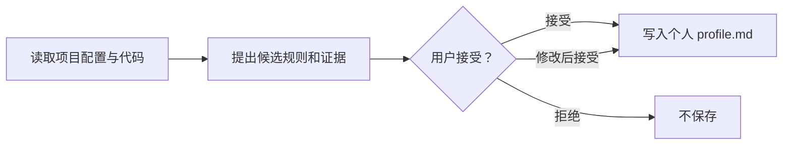

# Personal Coding Style

**让编码 Agent 延续项目代码习惯，并从你打开的项目中提炼可复用的个人偏好。**

这是一个纯 Agent Skill，只使用 Agent 自带的文件读取和编辑能力。无需 Web 页面、MCP、服务端或依赖安装。

## 目录

- [快速开始](#快速开始)
- [安装位置](#安装位置)
- [添加个人规则](#添加个人规则)
- [设置项目规则](#设置项目规则)
- [从项目学习习惯](#从项目学习习惯)
- [常见问题](#常见问题)

## 快速开始

1. 将 `skills/personal-coding-style` 安装到下表中对应 Agent 的个人目录或项目目录。
2. 重新打开 Agent 会话，然后直接描述代码任务；也可以显式调用 `personal-coding-style`。
3. 编辑个人规则时，修改 `profile.md`；只对一个仓库生效的规则放入项目指令文件。

以下是安装到 **Codex 个人目录**的示例。其他 Agent 或项目级安装只需把目标路径换成下表对应目录。

**Windows PowerShell**（在本仓库根目录执行）：

```powershell
$destination = "$HOME\.codex\skills\personal-coding-style"
New-Item -ItemType Directory -Force $destination | Out-Null
Copy-Item .\skills\personal-coding-style\* $destination -Recurse
```

**macOS / Linux**：

```sh
mkdir -p "$HOME/.codex/skills/personal-coding-style"
cp -R skills/personal-coding-style/. "$HOME/.codex/skills/personal-coding-style/"
```

## 安装位置

将技能文件夹复制到相应的 Skills 目录下，最终确保文件位于 `.../personal-coding-style/SKILL.md`。表格列出各 Agent 的个人级和项目级目录；安装后刷新或重新打开 Agent 会话。

| Agent | 个人级（跨项目） | 项目级（当前仓库） |
| --- | --- | --- |
| [Codex](https://learn.chatgpt.com/docs/build-skills) | `~/.codex/skills/` | `.agents/skills/` |
| [Claude Code](https://code.claude.com/docs/en/skills) | `~/.claude/skills/` | `.claude/skills/` |
| [Cursor](https://cursor.com/docs/skills) | `~/.cursor/skills/` | `.cursor/skills/` 或 `.agents/skills/` |
| [Trae CN](https://forum.trae.cn/t/topic/67755) | `~/.trae-cn/skills/` | `.trae/skills/` |
| [Qoder / Qoder CN（通义灵码）](https://docs.qoder.com/extensions/skills) | `~/.qoder/skills/` | `.qoder/skills/` |
| [腾讯 CodeBuddy](https://www.codebuddy.ai/docs/ide/Features/Skills) | `~/.codebuddy/skills/` | `.codebuddy/skills/` |

Windows 下将 `~` 替换为 `%USERPROFILE%`。Codex 也支持用 `CODEX_HOME` 指定个人配置目录。部分 Agent 提供 Skill 导入界面，也可以通过界面导入 `SKILL.md` 或整个技能文件夹。

## 添加个人规则

编辑全局个人偏好文件：

```text
Windows:     %USERPROFILE%\.personal-coding-style\profile.md
macOS/Linux: ~/.personal-coding-style/profile.md
```

文件或目录不存在时先创建，然后添加清晰、可执行的规则。下面的内容可以直接复制后修改：

```markdown
# 我的代码习惯

## Python
- 文件路径优先使用 `pathlib` 处理。
- 函数聚焦单一职责；复杂逻辑拆分为小函数。

## 通用
- 修改行为时补充或更新对应测试。
- 注释解释设计原因，不重复描述代码本身。
```

保存后，Skill 会指引 Agent 在后续任务中读取这份文件。需要修改或删除习惯时，直接编辑它即可。Agent 无法访问个人目录时，可在当前项目的指令文件中加入相同内容。

## 设置项目规则

只在一个仓库生效的约定应写入该项目的指令或规则配置，不要放进全局个人档案。例如，Codex 项目可在仓库根目录的 `AGENTS.md` 中写：

```markdown
# 项目约定

- 遵循仓库的格式化和 lint 配置。
- 对无效输入和空状态优先使用早返回。
- 错误处理沿用当前模块的既有模式。
- 行为变化时补充或更新测试。
```

Claude Code 项目可使用 `CLAUDE.md`；其他 Agent 使用其项目级规则入口。项目指令、格式化配置和相邻代码与个人偏好冲突时，**优先遵循项目约定**。已有指令文件时请合并内容，不要覆盖原有规则。

Qoder CN（通义灵码）还提供产品内规则设置；项目规则目录和规则类型见[官方规则说明](https://help.aliyun.com/zh/lingma/user-guide/rules)。

## 从项目学习习惯

在已打开的项目中请求：

> 分析这个项目的代码习惯，区分团队约束和个人偏好，给我带文件证据的候选规则。

Agent 检查项目配置和代表性代码，汇报候选规则及其相对路径证据。项目的强制配置会作为项目约束，不会自动算作个人偏好。



推断出的规则不会自动保存；只有用户明确接受后，Agent 才会更新个人偏好文件。

## 常见问题

- **Skill 没有加载：** 检查文件是否位于 `skills/personal-coding-style/SKILL.md` 这一层级，并重启或刷新 Agent 会话。
- **规则没有生效：** 确认偏好文件可读取；若与项目规则冲突，以项目规则为准。
- **规则只想用于当前仓库：** 把它写入该 Agent 的项目指令或规则配置，不要写入全局 `profile.md`。

---

无需安装依赖或启动服务。
